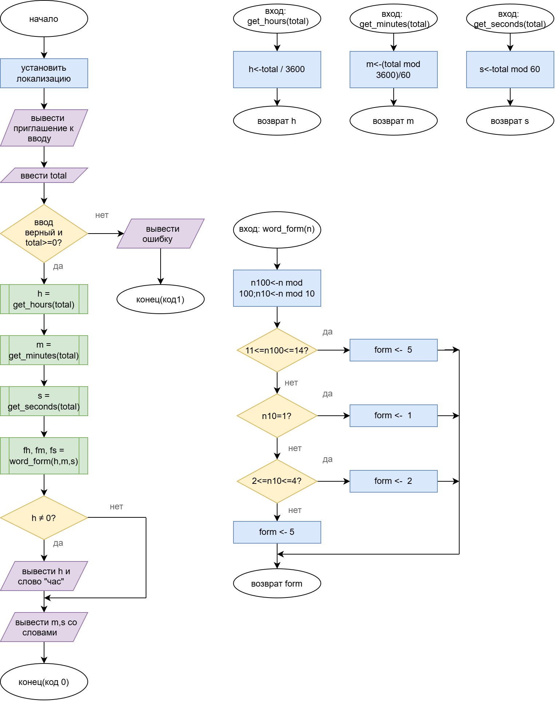

# Домашнее задание к работе 6
## Вариант 2
## Условие задачи

Написать программу, которая переводит время из секунд в целое значение часов, минут и секунд. Если значение часов равно 0, то слово «час» не выводится.

## 1. Алгоритм и блок-схема

### Алгоритм

1. Начало.
2. Установить локализацию.
3. Вывести приглашение к вводу.
4. Ввести `total` — время в секундах.
5. Если ввод некорректен или `total < 0` — вывести сообщение об ошибке и завершить программу с кодом 1.
6. Вызвать функции и сохранить результаты:
   - `h = get_hours(total)` — часы: `total / 3600` (целая часть);
   - `m = get_minutes(total)` — минуты: `(total mod 3600) / 60`;
   - `s = get_seconds(total)` — секунды: `total mod 60`.
7. Для каждого числа определить форму слова функцией `word_form(n)`:
   - если `n mod 100` от 11 до 14 → форма 5 («часов»);
   - иначе если `n mod 10 = 1` → форма 1 («час»);
   - иначе если `n mod 10` от 2 до 4 → форма 2 («часа»);
   - иначе → форма 5 («часов»).
8. Если `h ≠ 0` — вывести часы со словом в нужной форме.
9. Вывести минуты и секунды со словами в нужной форме.
10. Конец.

### Блок-схема

https://drive.google.com/file/d/18XlyNcJNrBaoFc98tCD9D1WBiwFaRYLp/view?usp=sharing

## 2. Реализация программы
```c
/*
 * Контрольные примеры:
 *   125   -> 2 минуты 5 секунд              (часов 0 — слово «час» не выводится)
 *   0     -> 0 минут 0 секунд               (граница: минимальное значение)
 *   3599  -> 59 минут 59 секунд             (граница: последнее значение без часов)
 *   3600  -> 1 час 0 минут 0 секунд         (граница: первое значение с часами)
 *   7322  -> 2 часа 2 минуты 2 секунды
 *   40271 -> 11 часов 11 минут 11 секунд    (11 — особый случай: «часов», а не «час»)
 *   75661 -> 21 час 1 минута 1 секунда
 *   -5    -> сообщение об ошибке
 */
#define _CRT_SECURE_NO_WARNINGS
#include <stdio.h>
#include <locale.h>

int get_hours(int total);
int get_minutes(int total);
int get_seconds(int total);
int word_form(int n);

int main(void)
{
    int total;
    int h, m, s;
    int fh, fm, fs;

    setlocale(LC_ALL, "Russian");

    printf("Введите время в секундах: ");
    if (scanf("%d", &total) != 1 || total < 0)
    {
        printf("Ошибка: нужно ввести целое неотрицательное число.\n");
        return 1;
    }

    h = get_hours(total);
    m = get_minutes(total);
    s = get_seconds(total);

    fh = word_form(h);
    fm = word_form(m);
    fs = word_form(s);

    printf("%d сек = ", total);
    if (h != 0)
        printf("%d %s ", h, fh == 1 ? "час" : (fh == 2 ? "часа" : "часов"));
    printf("%d %s %d %s\n",
           m, fm == 1 ? "минута" : (fm == 2 ? "минуты" : "минут"),
           s, fs == 1 ? "секунда" : (fs == 2 ? "секунды" : "секунд"));

    return 0;
}

int get_hours(int total)
{
    int h;
    h = total / 3600;
    return h;
}

int get_minutes(int total)
{
    int m;
    m = (total % 3600) / 60;
    return m;
}

int get_seconds(int total)
{
    int s;
    s = total % 60;
    return s;
}

/* Форма слова после числа n: 1 — «час», 2 — «часа», 5 — «часов» */
int word_form(int n)
{
    int n100, n10, form;
    n100 = n % 100;
    n10 = n % 10;
    if (n100 >= 11 && n100 <= 14)
        form = 5;
    else if (n10 == 1)
        form = 1;
    else if (n10 >= 2 && n10 <= 4)
        form = 2;
    else
        form = 5;
    return form;
}
```
## 3. Результаты работы программы
```
Введите время в секундах: 125
125 сек = 2 минуты 5 секунд

Введите время в секундах: 0
0 сек = 0 минут 0 секунд

Введите время в секундах: 3599
3599 сек = 59 минут 59 секунд

Введите время в секундах: 3600
3600 сек = 1 час 0 минут 0 секунд

Введите время в секундах: 7322
7322 сек = 2 часа 2 минуты 2 секунды

Введите время в секундах: 40271
40271 сек = 11 часов 11 минут 11 секунд

Введите время в секундах: 75661
75661 сек = 21 час 1 минута 1 секунда

Введите время в секундах: -5
Ошибка: нужно ввести целое неотрицательное число.
```
## 4. Информация о разработчике

Бакатанова Алла, группа бИД-261 пдг2

